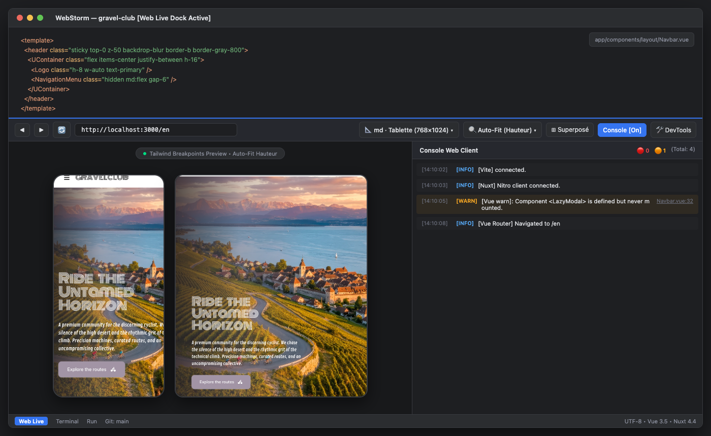

# 🌐 Web Live Dock — JetBrains Plugin

<p align="center">
  
</p>

<p align="center">
  <b>Aperçu Web en direct et Console Client temps réel pour Nuxt, Vue & Web</b><br>
  <i>Développé par <b>Kothea Studio</b> pour WebStorm & toute la suite JetBrains</i>
</p>

<p align="center">
  
  
  
</p>

---

## 📸 Présentation en Action

<p align="center">
  
</p>

---

## 🎯 Pourquoi Web Live Dock ?

En développement web moderne (**Nuxt 3/4**, **Vue 3**, **Vite**, **Next.js**) :
1. Le **Terminal** affiche uniquement les logs serveur (processus Node.js / SSR).
2. Pour observer les **erreurs client**, les alertes Vue et les **mismatchs d'hydratation**, le développeur doit constamment basculer sur un navigateur externe avec F12 ouvert.
3. Les plugins de preview existants ouvrent une vue scindée verticale qui réduit l'espace de code ou imposent de modifier la taille du volet pour voir un mobile ou une tablette.

### Solution apportée :
Un volet inférieur rétractable (**ToolWindow ancrée en bas**) comprenant :
* **À gauche :** La page web locale (`http://localhost:3000`), dézoomée avec le mode **Auto-Fit (Hauteur)** pour afficher un **smartphone ou une tablette en entier sans aucun scroll vertical**.
* **À droite :** La **Console Web Client** capturée en temps réel, mettant en évidence les erreurs JavaScript, avertissements Nuxt/Vue et exceptions réseau avec **saut direct au code source par double-clic**.

---

## ✨ Fonctionnalités Majeures

### 1. 📐 Simulateur Responsive & Breakpoints Tailwind CSS
Basculez instantanément entre les déclencheurs de responsive design standards :
* **Responsive (100%)** : Pleine largeur adaptative.
* **Mobile (<sm · 390×844)** : Format iPhone standard.
* **sm · Phablet (640×960)** : Breakpoint Tailwind `sm:`.
* **md · Tablette (768×1024)** : Format iPad & breakpoint Tailwind `md:`.
* **lg · Laptop (1024×768)** : Breakpoint Tailwind `lg:`.
* **xl · Desktop (1280×800)** : Breakpoint Tailwind `xl:`.
* **2xl · Large (1536×960)** : Breakpoint Tailwind `2xl:`.

### 2. 🔍 Mode Auto-Fit (Hauteur)
* Calibre automatiquement le zoom Chromium pour que **l'intégralité du mockup tienne dans la hauteur de votre dock**.
* Vous voyez l'en-tête, le contenu et le pied de page de votre application mobile sans devoir redimensionner la fenêtre de l'IDE.

### 3. 🔴 Console Web Client avec Saut Source au Double-Clic
* Capture les `console.error`, `console.warn`, `console.log`.
* **Double-cliquer sur un log ouvre directement le fichier source dans l'éditeur** (ex: `pages/index.vue:14`).
* Filtres par gravité et recherche instantanée par mot-clé.

### 4. 👁️ Masquage Console & Orientation Flexible
* **Masquer la console (Bouton Console)** : Donne 100% de la largeur du dock à la prévisualisation web.
* **Bascule d'orientation (Bouton Superposé/Côte-à-côte)** : Permet d'empiler verticalement ou d'aligner horizontalement.

---

## 📦 Installation

1. Téléchargez la dernière archive prête à l'emploi :
   * [`release/jetbrains-web-preview-1.1.0.zip`](../release/jetbrains-web-preview-1.1.0.zip)
2. Dans WebStorm / IntelliJ : **Settings (`Cmd + ,`) > Plugins > ⚙️ > Install Plugin from Disk...**
3. Choisissez le fichier `.zip` et redémarrez l'IDE.
4. L'onglet **Web Live** apparaît dans la barre d'outils inférieure.

---

## 🛠️ Compilation

```bash
cd jetbrains-web-preview
./gradlew buildPlugin
```
L'archive distribuable sera générée et copiée automatiquement dans `../release/jetbrains-web-preview-1.1.0.zip`.

---

© 2026 **Kothea Studio**. Tous droits réservés.
